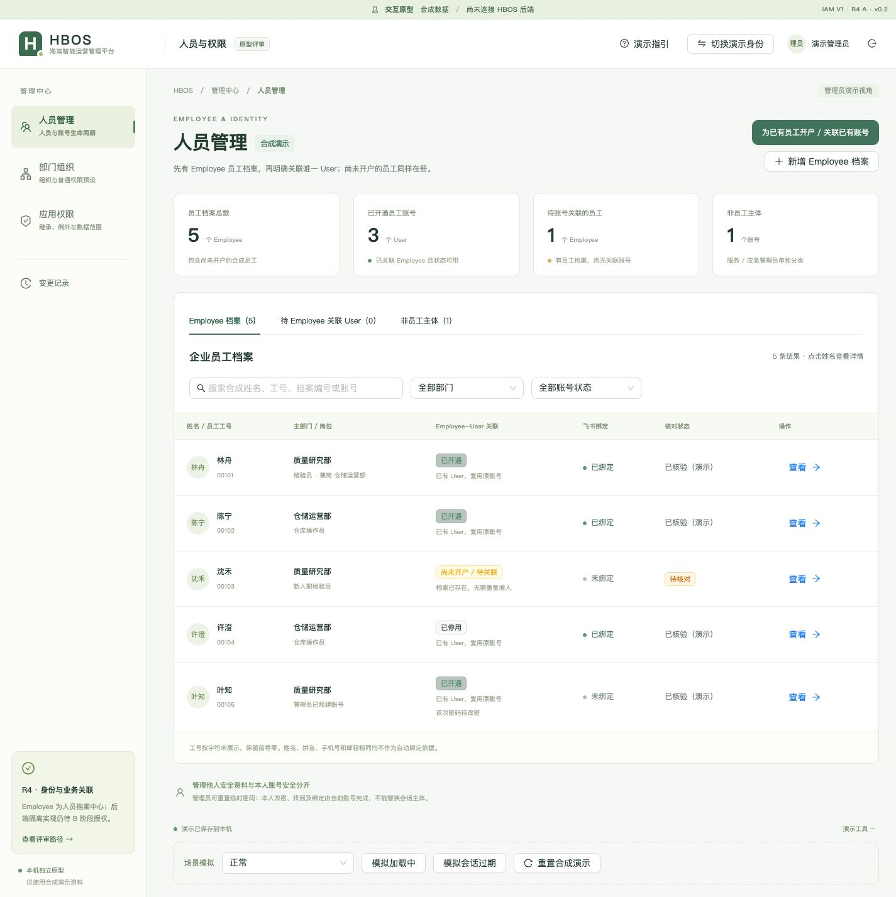
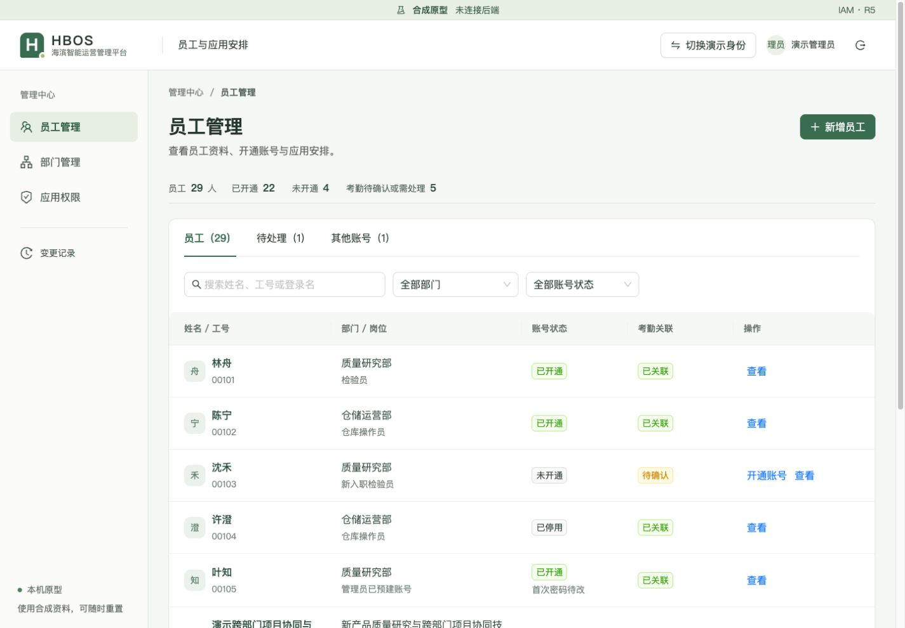
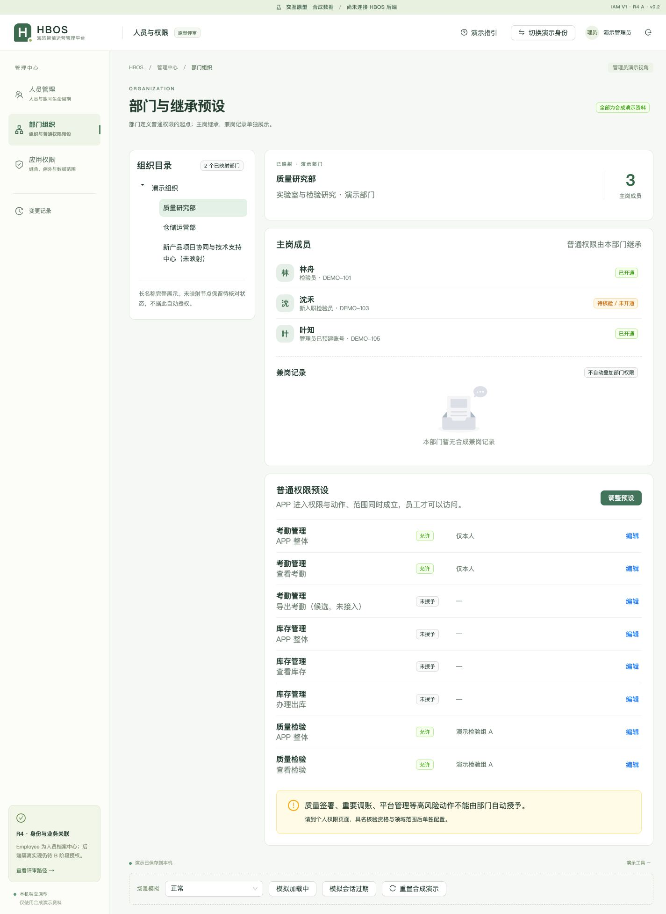
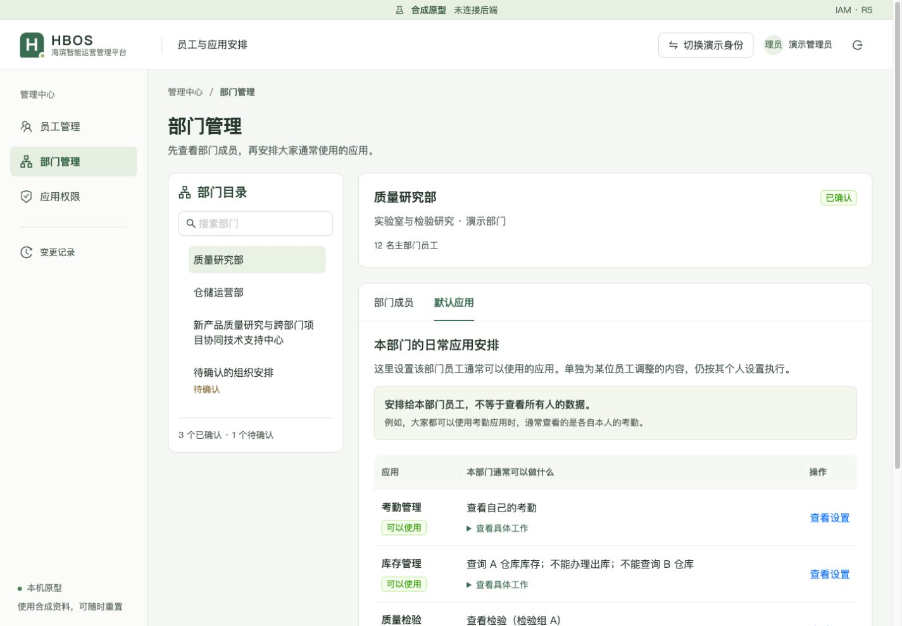
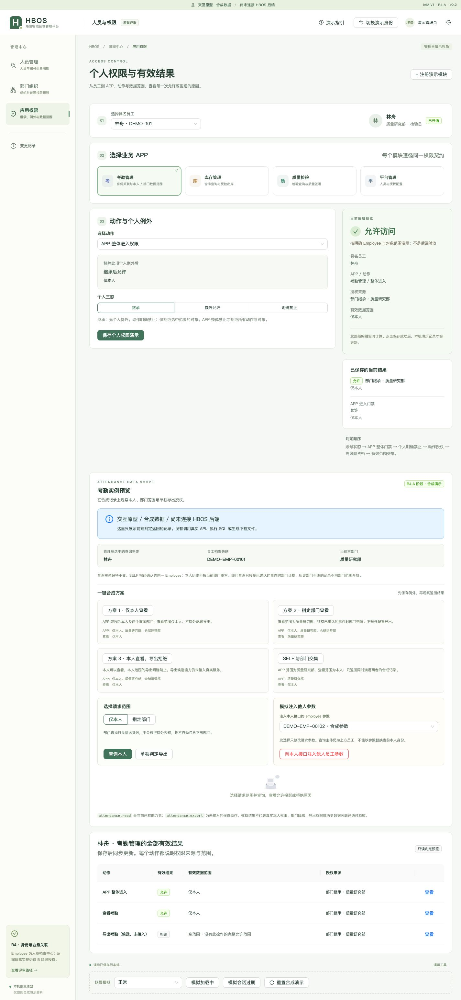
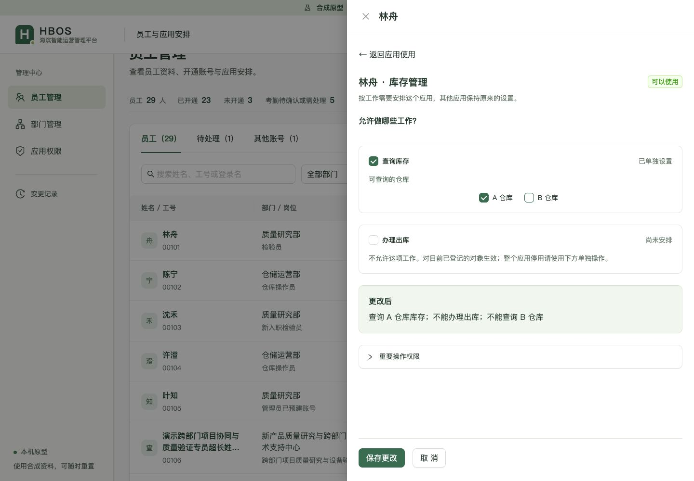
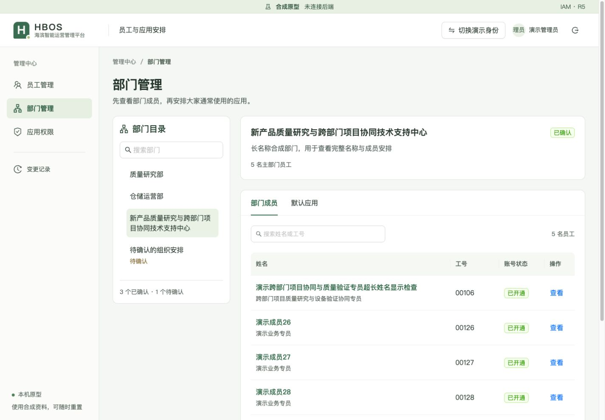
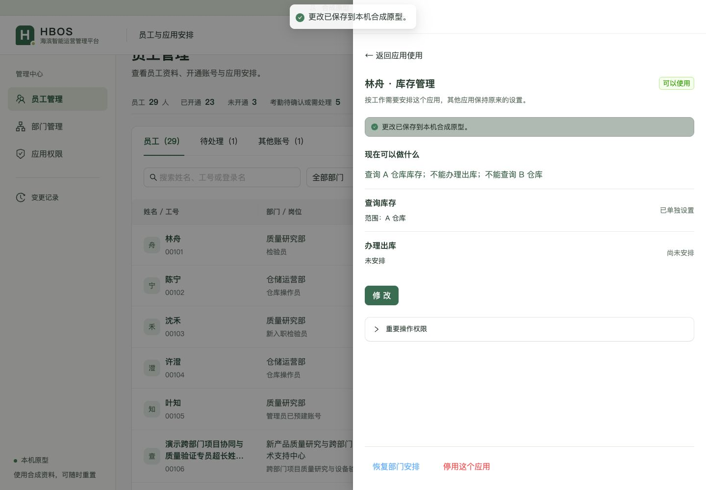

# R5 原型改造交付

状态：`IAM_V1_R5_USABILITY_PROTOTYPE_REVIEW_READY` · Owner：`PENDING_OWNER`。

[打开原型](http://iam-prototype.localhost:5197/)即可进入员工管理，无需先打开演示指引。使用合成资料，未连接后端。五个日常任务已由 Agent 在浏览器走通；非技术管理员易用性仍待 Owner 本人体验。

## 版本与范围

| 项目 | 冻结依据 |
| --- | --- |
| 实际目录 | `/Users/hb/Projects/HBOS-IAM-V1` |
| 继续使用的分支 | `design/iam-v1-r4-identity-attendance-20261015` |
| 同一 Draft PR | [#51 · DESIGN ONLY / 不合并](https://github.com/zjl327707743/HBOS-Platform/pull/51) |
| 产品来源 | `39366822a5b5d6041b9eea94da4f77255ad26761`；交付前重新 fetch，无漂移 |
| R4 起点 | `d1573ddbe05a0bd09120918e7dd4b00a5aa639b5` |
| 新 R5 HEAD | 本报告所属 R5 提交；本地交付冻结本及 `R5_版本冻结.json` 记录完整 SHA |
| R3 保留 | `e7486a9cb3ded7a32a9ead17990e158562605d44`，原分支与 Draft #50 保留 |

仅追加 `prototypes/iam-v1/**` 与 `docs/design/iam-v1/**`。主要差异：三管理页、统一壳体/样式、共享员工抽屉和工作设置、考勤结果卡、最小变更适配/提交、合成种子与独立 R5 存储、R5 测试及设计证据。完整相对 R4 文件清单和 patch 随本地冻结包交付。R4 开工单与原交付记录未改写。

## 改前与改后

| 页面 | R4 改前 | R5 改后 |
| --- | --- | --- |
| 员工 |  |  |
| 部门 |  |  |
| 个人应用 |  |  |

现在先展示“可以做什么”和来源，修改时逐项选择工作与对象。员工页、应用总览进入同一个抽屉、同一个设置组件和保存命令。部门先看成员，再看普通默认安排；重要操作另区只读。

## 五个任务的实际结果

以下均使用合成场景，按操作顺序记录；验收后已恢复 R5 初始场景，方便 Owner 自己体验。

| 任务 | 实际点击路径 | 可观察结果 |
| --- | --- | --- |
| 给已有员工开户 | 员工管理 → 沈禾行“开通账号” → 核对归属 → 确认 → 清空一次临时密码 | 未开通变已开通，员工总数仍29；账号复用原档案，临时密码不留在截图 |
| 理解本人考勤 | 林舟 → 应用使用 → 考勤管理“修改” | 已保存页直接说明只能看本人、看不到同事；显示同一档案的两条当前/历史记录；部门查询、导出暂未开放 |
| 只查询A仓 | 林舟 → 应用使用 → 库存管理 → 修改 → 查询选A、出库不选 → 保存 | 实测先扩为A+B再缩为A；结果明确不能查B、不能办理出库；合成判定与摘要一致 |
| 停用一个应用 | 同一库存设置 → 停用这个应用 → 一次确认 | 库存显示已停用，账号仍已开通、考勤和质量检验仍可用；重新启用先预览，恢复原A仓查询而非全部能力 |
| 部门与调岗 | 库存“恢复部门安排” → 核对实际结果并确认；基本资料 → 调岗 → 选仓储运营部 → 查看前后并确认；部门管理 → 默认应用 → 修改并一次保存 | 个人普通设置撤除后，质量研究部原无库存安排，显示未开通；调岗获得新部门普通安排、失去旧部门检验安排，两条本人历史未变。部门保存显示状态推导的12名调整/0名单独设置保持/0人暂不可用，保存一次 |

另外从“应用权限 → 库存管理 → 林舟”进入同一设置：模拟保存失败后，取消出库的草稿仍保留；关闭提示放弃，重新从员工入口打开仍是原已保存安排。切回正常后保存成功。版本冲突由统一命令测试覆盖，未另做浏览器冲突场景。

## 验证与待确认

| 项目 | 结果 |
| --- | --- |
| 日常五任务、保存失败/放弃、双入口一致、键盘Space选择仓库 | PASS（Agent 实测） |
| 100%桌面：1280×900、1440×1000、1920×1080 | PASS；三主页面检查，主页面无水平溢出，1920时容器上限1280，部门目录280 |
| 长名称、零条搜索/未确认部门、5人部门、29人多页数据 | PASS；完整名称可进入详情，未确认节点不可分配 |
| 640×900补充窄屏 | PASS；工作抽屉全宽，保存区可见；不替代真实200%缩放 |
| 真实200%浏览器缩放 | NOT_RUN；可用工具只有视口能力，缩放快捷键未使比例生效 |
| 原型测试 / 构建 / whitespace | PASS；原41项文件及断言不变；R5关键映射见附件。构建保留Ant Design大chunk提示 |
| 最终运行期新console error | 0（排除开发中未完成文件的旧HMR记录） |
| Owner易用性 / 正式B、C | PENDING_OWNER / NOT_RUN |

登录Hero、首次企业开户/预建复用、同账号双登录方式、本人改密/MFA/恢复/换绑、身份冲突/停用、本人参数拒绝、历史归属和动作与对象成对判定均保留。重要权限、未开放导出不会随普通查看获得。原型实现不能证明真实SQL、Session、OAuth或数据库验收。

原型增加的最小工作patch、版本校验和停用备份结构，需要B开始前重新确认服务端命令映射，**不视为正式模型/API批准**。R4 B开工单继续留档，B/C未开始。本轮停在等待Owner体验。

## 本机启动与保留

在 `/Users/hb/Projects/HBOS-IAM-V1/prototypes/iam-v1` 运行 `npm start`、`npm run status`、`npm stop`。仅本机回环5197，当前已登记 PID 41726；脚本核对绝对路径与进程来源后才管理，不影响5196。重装依赖时才 `npm ci`。

R5只读写 `hbos.iam-v1.r5.synthetic.v5`；重置仅恢复R5合成状态，R3/R4存储、固定提交与旧交付目录保留。源码包排除依赖、dist、runtime、凭据及组织原件。工程映射与覆盖明细见 [R5适配与验证说明](R5_适配与验证说明.md)。
